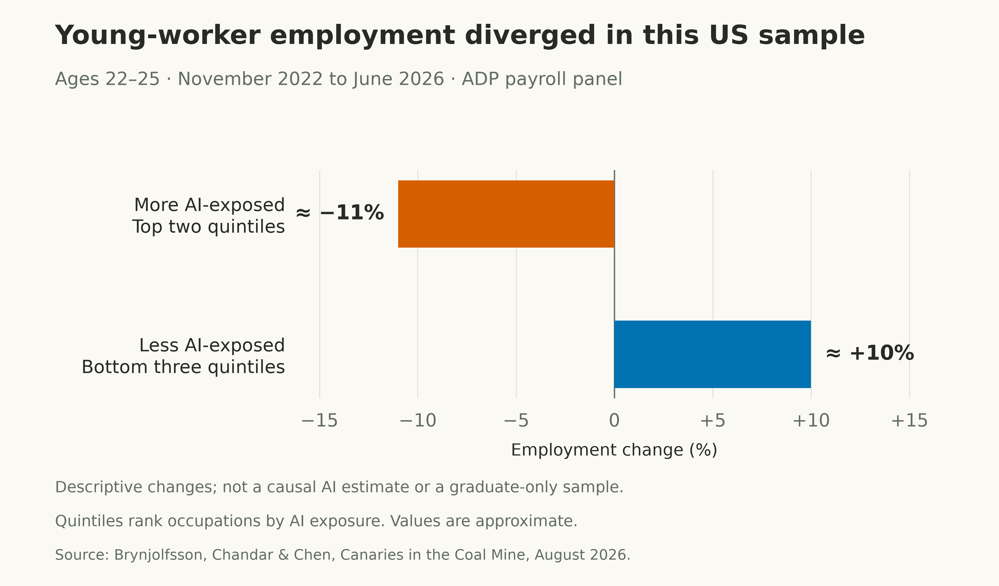
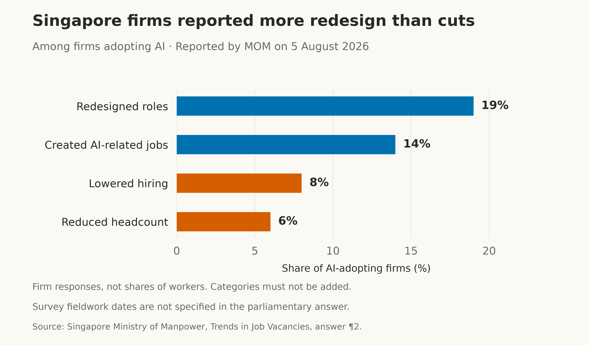
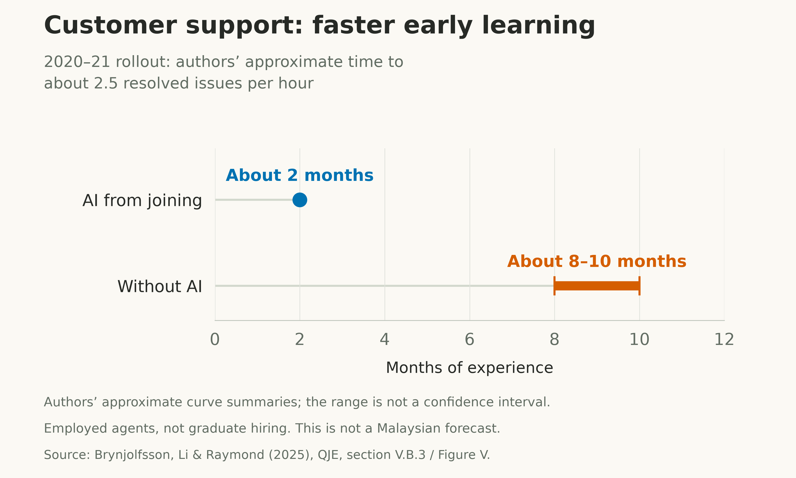
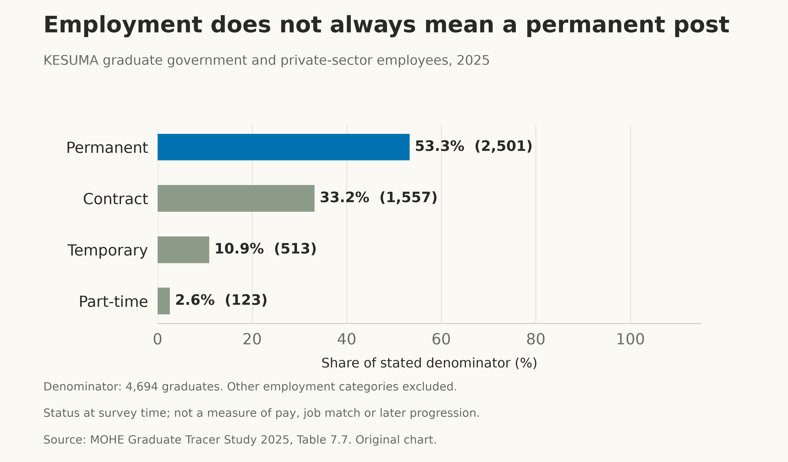

+++
title = "AI and the First Job: What Global Evidence Means for Young Malaysians"
description = "What observed hiring, employment and graduate outcomes reveal about AI, experience and first jobs—and what Malaysia should measure before choosing its response."
slug = "ai-beginner-work-malaysia"
article_id = "ai-beginner-work-malaysia"
genre = "essay"
date = 2026-10-24T09:00:00+08:00
draft = true
time_sensitive = true
author = "Meor Ajrul"
tags = ["AI", "work", "Malaysia", "education", "TVET"]

[cover]
image = "hero-first-job.png"
alt = "AI-generated editorial still life of a graduation cap, open notebook and laptop on a sunlit desk."
caption = "AI-generated editorial illustration."
relative = true
hidden = false
+++

Getting better at a job and getting the chance to start one are different questions. For a young Malaysian choosing a course or applying for work, that distinction matters more than a confident prediction about which careers AI will leave behind.

The evidence now gives us reasons to scrutinise first-job access. Some overseas studies find weaker employment growth for young workers or a shift towards senior employees. Other findings show changing tasks without comparable losses in average earnings, or entry-level vacancies holding up. None establishes a single path that Malaysia must follow.

The useful question is what these measured changes tell us about entry into work—and what we still need to know before advising the next generation.

## Where young workers are facing pressure

[Stanford's August 2026 payroll study](https://digitaleconomy.stanford.edu/app/uploads/2026/08/Canaries_August2026.pdf) follows a sample of US workers through June 2026. Between November 2022 and June 2026, employment among 22–25-year-olds fell about **11% in the two most AI-exposed occupation groups**, while growing about **10% in the three least-exposed groups**. The groups are quintiles: five bands ranked by exposure.

The difference arose mainly through reduced hiring rather than increased departures. Experienced workers showed no comparable gap between more- and less-exposed occupations.

*Approximate observed changes in the payroll sample; not a causal AI estimate. [Chart data](us-young-worker-employment.csv).*

This is descriptive evidence, not an estimate of jobs destroyed by AI. Some trends began before ChatGPT; differences in education matter; the gap is more pronounced in this payroll sample than in national surveys. Ages 22–25 also do not identify graduates specifically. The finding warrants attention without establishing a nationwide graduate-employment collapse.

## Is employment shifting towards seniors?

A [September 2026 working paper covering 41 countries](https://digitaleconomy.stanford.edu/app/uploads/2026/09/HowDoesAIChangeLaborDemand.pdf) examines multinational firms' foreign affiliates using records from January 2021 to March 2026. It infers company AI adoption from job advertisements mentioning generative-AI work.

By March 2026, its estimated junior workforce share at adopting affiliates was **1.9 percentage points below comparable controls**. This mainly reflected senior employment growth: the senior estimate was **6.7% higher**, while the junior estimate was **2.5% lower and not statistically significant**. A falling junior share is therefore different from a demonstrated fall in junior headcount.

The estimates depend on an assumption: adoption by firms near a foreign parent's headquarters affects the affiliate's employment only through that company's AI adoption. The authors test its plausibility; those tests cannot establish it as fact. These digitally connected multinationals do not represent every employer, and the study's seniority categories do not identify graduate cohorts.

This supports examining a shift towards seniors in a particular setting. It does not establish that experience always makes someone better at using AI, or explain every employer's hiring decision.

## The other evidence belongs in the same picture

In [Denmark, researchers linked chatbot-adoption surveys to administrative records](https://www.andershumlum.com/s/chatbots_260313.pdf) across 11 exposed occupations. They found changes in tasks but estimated average earnings and recorded-hours effects close to zero, ruling out effects larger than 2%. They also found no differential decline in early-career employment share at adopting workplaces.

Those records end in **December 2024**, although the paper was revised in March 2026. Its comparisons depend on observational research assumptions. It cannot settle the effects of later AI systems or establish that every worker was unaffected.

A separate [US study of recent graduates](https://docs.iza.org/dp18945.pdf), using national survey data through **August 2026**, found no statistically significant unemployment increase in summer 2026 relative to its comparison groups and periods. Its graduate definition covers 22–25-year-olds whose highest qualification is a bachelor's degree and who are not in school. It cannot isolate AI from other economic changes.

Singapore supplies a nearby comparison. Its [Ministry of Manpower reported](https://www.mom.gov.sg/newsroom/parliament-questions-and-replies/2026/0805-written-answer-to-pq-on-trends-in-job-vacancies) that entry-level professional, managerial, executive and technician vacancies rose slightly, from **32,500 in December 2025 to 32,800 in March 2026**. Among firms adopting AI, reported role redesign was more common than reported headcount reduction.

*Source: MOM parliamentary answer, 5 August 2026. The answer does not specify survey fieldwork dates. Responses are not treated as mutually exclusive; do not add them. [Chart data](singapore-ai-employer-responses.csv).*

Vacancies are not completed hires, and employer reports do not establish causal effects. Together, these studies describe different populations, periods and outcomes. They should not be averaged into a single global AI job-loss rate.

## AI can help beginners who already have a job

The strongest challenge to a blanket senior advantage remains [*Generative AI at Work*](https://doi.org/10.1093/qje/qjae044). Among 5,172 customer-support agents, mostly based in the Philippines, less-experienced and lower-skilled workers gained more from AI assistance. The rollout mainly took place in autumn 2020 and winter 2021.

*Original visual summary of section V.B.3 and Figure V. The 8–10-month range is the authors' narrative approximation, not a confidence interval or a new calculation. The rollout was not random. [Chart data](ai-learning-curve.csv).*

This is evidence about employed agents at one firm and its contractors. It shows why novice productivity and first-job access must be examined separately. It does not establish whether employers will recruit more beginners.

There is also evidence that hiring criteria can change. [Anthropic's October 2026 study of its own workplace](https://www.anthropic.com/research/employment-at-anthropic) reports greater emphasis on autonomy and judgment in hiring decisions. It draws on internal records and interviews. One rapidly expanding AI company reporting on itself is a bounded case, not a description of Malaysian employers or proof that technical knowledge no longer matters.

## What Malaysia's graduate data can actually tell us

Malaysia already publishes outcomes worth examining. [The Ministry of Higher Education's 2025 Graduate Tracer Study tables](https://mohe.gov.my/muat-turun/statistik/2025-1-1/1845-bab-7-skpg-2025-pdf/file), which include English labels, report **5,367 employed and 339 unemployed graduates from Ministry of Human Resources (KESUMA) institutions**: a **94.1% employment rate** within that labour-force group of 5,706.

[MOHE's English definition](https://ge.mohe.gov.my/CarianGraduateEmploymentBI.aspx) excludes graduates outside the labour force and records status shortly after graduation. Earlier, pre-2024 “employability” measures also included further study, training and waiting for placement. Those figures should not be joined into one employment trend.

*MOHE, Table 7.7, 2025. This employee denominator differs from the employment-rate denominator and excludes other employment categories. [Position data](kesuma-graduate-position-2025.csv); [employment data](kesuma-graduate-employment-2025.csv).*

These results describe employment and position type at survey time. They do not establish wages, whether work matches training, later progression, or an AI effect. The inspected chapter supplies no response rate or confidence interval for these rows.

## TVET needs an outcome test too

The [ILO's 2025 exposure study](https://www.ilo.org/sites/default/files/2025-05/WP140_web.pdf) assesses clerical work as most exposed to generative AI and manual tasks as less exposed. Its scores combine worker survey responses, expert judgment and AI predictions; tasks receive equal weights because their relative frequency and importance are unavailable.

That is an assessment of technical exposure, not observed job destruction or future demand. It does not assess protection from every form of automation, including robotics. It cannot establish that physical work will grow because AI performs more cognitive tasks.

Malaysia's current vacancies give us another starting point:

*[DOSM, Employment Statistics, Q2 2026](https://www.dosm.gov.my/portal-main/release-content/employment-statistics-Q22026), released 13 August 2026. Rounded survey estimates for covered registered private-sector businesses. [Chart data](malaysia-vacancies-q2-2026.csv).*

Those occupational categories do not identify required qualifications, beginner eligibility or the reasons vacancies remain unfilled. TVET deserves assessment against actual occupations and graduate outcomes. Neither the vacancy totals nor exposure scores tell us which courses should expand.

## A more useful task for TalentCorp and KESUMA

[TalentCorp's MyCOL](https://www.talentcorp.com.my/mycol/) uses employer surveys and industry engagement to identify occupations in demand and skills imbalances across 18 sectors. Its [MySIP programme](https://www.talentcorp.com.my/mysip-incentives/) supports structured internships, including for TVET students, with learning modules and evaluations. These establish existing instruments and programme design; they do not establish a causal improvement in later employment.

The overseas evidence suggests questions for evaluating Malaysia's response. The following are recommendations, not findings that these interventions have already succeeded:

- **For TalentCorp:** track whether monitored vacancies accept beginners, what experience they require, and how many junior hires actually result. Compare these measures over time alongside measured employer AI adoption.
- **For KESUMA:** follow graduates and internship participants beyond initial placement. Publish course-level pay, job match and retention at six and twelve months, with response rates and clear denominators. Claims of programme effectiveness would also need credible comparisons with non-participants.
- **For employers:** assess what junior applicants can demonstrate with AI and how they check its output. Evaluate supervised learning and progression rather than assume that years of experience fully measure capability.
- **For students:** ask providers for those course-level outcomes and employers for concrete entry requirements. Practise using AI on assessed work and checking its results. This is preparation advice, not a guarantee that a qualification or portfolio will secure employment.

## The next generation needs a route into work

The concern about seniors getting a head start has some support in observed employment patterns. It is not a universal rule about who benefits from AI. The same evidence base includes novice productivity gains, changing tasks and settings without comparable entry-level declines.

For Malaysia, the priority should be to examine access to that first job and the quality of the work that follows. University and TVET pathways both deserve that scrutiny. The evidence reviewed here cannot tell a student which career will be safe in ten years. It can tell us why training places, initial employment, relevant work and sustained progression need separate measures—and why a confident forecast cannot substitute for them.
