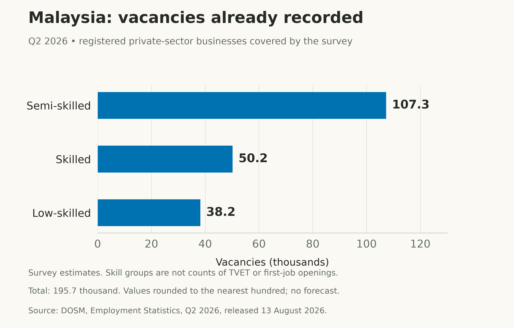

+++
title = "AI, First Jobs and TVET: What Malaysia Can Learn from China"
description = "China is adjusting education to anticipated industry needs. What do recruitment studies, Malaysian vacancies and AI research actually establish for young workers and TVET?"
slug = "ai-beginner-work-malaysia"
article_id = "ai-beginner-work-malaysia"
genre = "essay"
date = 2026-10-23T09:00:00+08:00
draft = true
time_sensitive = true
author = "Meor Ajrul"
tags = ["AI", "work", "Malaysia", "China", "education", "TVET"]

[cover]
image = "china-programme-changes.png"
alt = "China's 2024 undergraduate programme decisions, reported in April 2025: 1,839 offerings added, 2,220 stopped admitting students, 1,428 withdrawn and 157 changed degree category or duration. Counts concern institution-level offerings, not graduates or jobs."
caption = "China's reported education changes. Source: Ministry of Education, April 2025. These administrative counts do not measure whether labour shortages fell."
relative = true
hidden = false
+++

What should a young Malaysian train for as AI changes work? China offers evidence of an attempt to answer that question through education planning. It also offers recruitment evidence that deserves a careful reading.

China's records describe anticipating industry needs and changing what institutions teach. They do not establish whether the predictions proved accurate or graduates filled the expected gaps.

The same care applies to experience and technical and vocational education and training, or TVET. The research does not establish that seniors always benefit more from AI, or that physical work will inevitably become more plentiful. There is still useful evidence to examine.

## What the evidence says about experience

[Research by Mingyou Liu and Yitao Wang](https://doi.org/10.1016/j.techsoc.2026.103487) examines more than a million Chinese AI-related job advertisements from 2018 to 2025. The abstract reports increasingly selective recruitment, including greater demand for postgraduate qualifications and candidates with one to five years of experience.

That is evidence about advertised requirements in a particular labour market. It is relevant to newcomers who have not yet accumulated that experience. The evidence inspected here is limited to the abstract and public publisher preview; the full methods have not been appraised. Advertisements do not reveal completed hires or establish that AI caused China's wider youth employment difficulties.

There are also accounts of experienced staff taking on work previously done by juniors. A [South Korean preprint by Sumin Yu and Taesup Moon](https://arxiv.org/html/2607.17067v1) reports this in interviews about software development with AI. Its 14 participants were recruited through personal and professional networks. These are reported experiences within a small sample, with no estimate of how widespread the pattern is in China or Malaysia.

The strongest counterweight comes from [*Generative AI at Work*](https://doi.org/10.1093/qje/qjae044). In a study covering 5,172 customer-support agents, mostly based in the Philippines, less-experienced and lower-skilled workers gained more from AI assistance. The rollout mainly took place in autumn 2020 and winter 2021.

*Original visual summary of section V.B.3 and Figure V. The approximate 8–10-month range comes from the authors' narrative, rather than a new time-to-target calculation. The rollout was not random, and the findings concern employed agents at one firm and its contractors. [Chart data](ai-learning-curve.csv).*

These results do not settle first-job access. They do rule out treating a general senior advantage as an established finding. China's advertised experience requirements and the customer-support study's novice productivity gains concern different outcomes.

## China is changing education around anticipated demand

China's [June 2026 account of graduate-employment measures](https://hudong.moe.gov.cn/jyb_xwfb/s5147/202606/t20260615_1440719.html) describes a national talent supply-and-demand data platform, forecasting for urgently needed fields, and data sharing to inform programme adjustments. This is an official account of the planning process. It does not publish a forecast-accuracy evaluation.

There are concrete records of education changes. For the 2024 undergraduate programme approval and filing round, [the Ministry of Education reported](https://hudong.moe.gov.cn/jyb_xwfb/gzdt_gzdt/s5987/202504/t20250422_1188245.html) 1,839 programme offerings added, 2,220 stopping admissions, 1,428 withdrawn, and 157 changing their degree category or duration. The announcement was published on 22 April 2025. The chart at the top of this article shows those counts.

Here, an offering means a programme at an institution. It is neither a student place nor a distinct subject nationwide. The figures are administrative changes, with no comparison showing what would have happened without the policy. [Chart data](china-programme-changes.csv).

The ministry also added 29 subjects to its 2025 undergraduate catalogue, including AI education and low-altitude technology and engineering. That documents a response to stated strategic and industry priorities. It does not establish how many graduates will find relevant jobs.

Vocational education is part of this effort. In February 2025, China [issued 758 new or revised vocational teaching standards](https://hudong.moe.gov.cn/jyb_xwfb/s271/202502/t20250211_1178747.html). The ministry says they covered 82.1% of institution-level vocational programme offerings recorded in 2024. The standards address advanced manufacturing and other fields, strengthen practical teaching, and incorporate digital and AI tools.

This supports a precise conclusion: China has documented arrangements for anticipating skills needs and revising education provision. The records examined here do not establish that it always predicts demand correctly, or that these changes have minimised labour gaps by the time industries expand. That outcome remains unverified here.

## TVET has a case grounded in demand already visible

For Malaysia, it is possible to start with vacancies rather than a prediction about AI.

[DOSM's Quarterly Employment Survey](https://www.dosm.gov.my/portal-main/release-content/employment-statistics-Q22026) estimated 195,700 vacancies in registered private-sector businesses in the second quarter of 2026. Of these, 107,300 were in the semi-skilled category, 50,200 in the skilled category, and 38,200 in the low-skilled category.

*Source: DOSM, Employment Statistics, Q2 2026, released 13 August 2026. Survey estimates of vacancies in covered registered private-sector businesses. Counts are rounded to the nearest hundred; the categories are not educational qualifications. [Chart data](malaysia-vacancies-q2-2026.csv).*

Manufacturing accounted for 114,000 vacancies, or 58.3% of the same total. That is a sector breakdown of the vacancies already counted above; it must not be added to the skill-category figures.

These figures establish existing demand in the covered businesses. They do not identify which vacancies require a TVET qualification, accept fresh graduates, offer progression, or pay enough to attract suitable applicants. A vacancy is also not, by itself, proof of a skills shortage: this release does not establish why each position is unfilled.

TVET deserves examination against these actual opportunities. The aggregate figures alone cannot establish which courses should expand or how many places they should add.

## Physical work and AI exposure are different questions

There is evidence behind part of the intuition about practical skills. The [ILO's 2025 occupational-exposure study](https://www.ilo.org/sites/default/files/2025-05/WP140_web.pdf) places clerical work at the highest exposure to generative AI and assesses manual tasks as less exposed. Its scores combine worker survey responses from Poland, expert judgments and AI predictions. Initial AI scoring used models available at the end of 2024. Tasks within each occupation receive equal weight because their relative frequency and importance are unavailable.

Those scores estimate technical exposure; they are not observed automation rates or forecasts of Malaysian vacancies. Nor does this measure establish protection from robotics or other automation. It cannot show that demand for physical work will grow because AI performs more cognitive tasks.

China's vocational standards also incorporate AI and digital teaching. They do not present vocational education as an escape from technology.

For a Malaysian student, the unanswered question is specific: which training programmes lead to sustained employment, relevant work, acceptable wages and progression? The vacancy totals and exposure estimates in this article do not answer it. Course-level graduate outcomes and occupation-level hiring evidence are needed before claiming that a particular TVET route is the future winner.

## What Malaysia can take from this

There is a useful practice to examine in China's approach: connecting education decisions to stated industry needs and updating provision. The education changes are documented. Their success in closing future gaps still needs to be demonstrated.

Malaysia's current vacancies give that discussion a factual starting point. The AI studies add a second reason for care: experience requirements can rise in a recruitment dataset while beginners gain more from an AI tool in a particular workplace. Neither finding settles the other.

The evidence supports taking TVET and first-job access seriously. It leaves open how much demand AI will create, which qualifications will be needed, and whether young Malaysians will receive the opportunities those qualifications are supposed to prepare them for.
