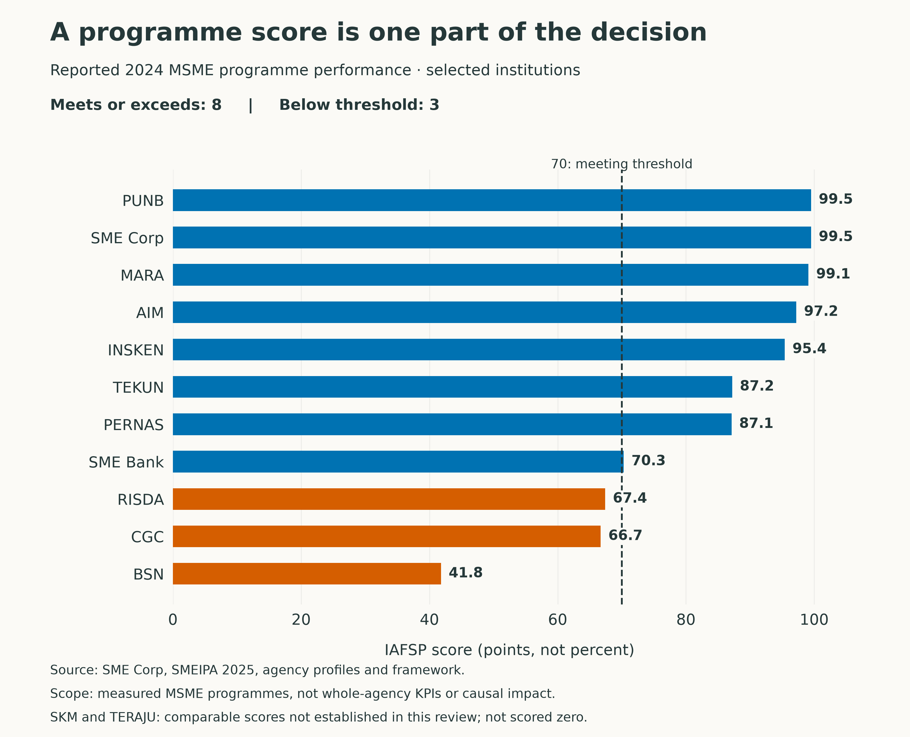
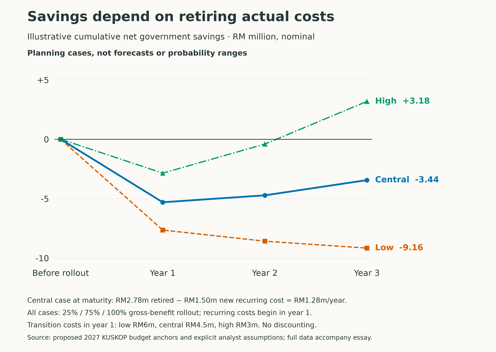

+++
title = "Can Malaysia merge its way to better MSME support?"
description = "Singapore merged agencies, Thailand joined services, and Indonesia shared a finance network. What can Malaysia copy, and what savings can it claim?"
slug = "can-malaysia-merge-msme-support"
article_id = "can-malaysia-merge-msme-support"
genre = "essay"
date = 2026-10-20T09:00:00+08:00
draft = false
time_sensitive = true
author = "Meor Ajrul"
tags = ["Malaysia", "Public policy", "Small business", "AI"]

[cover]
image = "hero.png"
alt = "Conceptual illustration of business owners entering one gateway that connects several specialist service pavilions in a Malaysian civic courtyard."
caption = "A shared entrance, with specialist services behind it. AI-generated conceptual illustration."
relative = true
+++

Why should a small business have to understand the organisation of government before it can find the right help?

That question offers Malaysia a useful starting point for reforming support for micro, small and medium enterprises. Count the agencies and the debate quickly becomes a contest over which name should disappear. Follow the business instead, and a more practical question emerges: which assessments, documents, referrals and administrative costs could government combine?

Singapore, Thailand and Indonesia offer three different answers. Singapore joined two agencies. Thailand built a common route to services. Indonesia put specialist financial institutions under a holding structure and developed shared outlets. Malaysia can learn from each, provided it is clear about what the evidence establishes.

The case for better coordination already has a Malaysian foundation. Khazanah Research Institute’s 2025 report, [*AI Governance in Malaysia: Risks, Challenges and Pathways Forward*](https://cdn.prod.website-files.com/684b55df28cddcbe52b406f2/690d93ef2c60698584f6b3f3_KRI-20AIIG-20Report-20Final_v4.7-20-upload-.pdf), identifies coordination and capacity problems in AI governance. Extending that concern to MSME delivery is the argument developed here; the report does not endorse the agency closures or savings scenarios below.

Malaysia also has institutions worth building on. The [ASEAN SME Policy Index 2024](https://www.eria.org/uploads/ASPI_2024-Full_report-upload-20Sep.pdf) describes an advanced Malaysian SME institutional framework. That assessment concerns policy arrangements, rather than proving that every programme performs well. It does, however, make a wholesale start from scratch difficult to justify.

Singapore provides the clearest completed agency merger in this comparison. International Enterprise Singapore and SPRING became [Enterprise Singapore on 1 April 2018](https://www.sgdi.gov.sg/ministries/meti/statutory-boards/enterprisesg). The resulting institution connects business capability, innovation and internationalisation. A firm improving its operations and preparing to enter another market can, in principle, be served along the same development journey.

The reform also reached the programmes. The Capability Development Grant and Global Company Partnership were brought together in the Enterprise Development Grant. A [2026 evaluation of EDG and EDG-I](https://isomer-user-content.by.gov.sg/1004/7cb36396-c58c-4bff-a50e-73a675a41bb7/FA_1Q26.pdf) found that a typical EDG grant was associated with annual revenue 1.9% higher and value added 1.6% higher. The EDG analysis used administrative data for 2019–2022 and controlled for firm and year effects and other grants.

This is useful evidence of programme benefits, with limits. The observational design may still be affected by differences between firms receiving grants and other firms that change over time. It does not isolate what the agency merger itself achieved.

The money requires equal care. Enterprise Singapore reported [S$118 million in expected annual cost reductions for businesses supported in 2025](https://www.enterprisesg.gov.sg/-/media/esg/files/media-centre/media-releases/2026/january/mr00326_annual-media-briefing-2026.pdf). These are expected company benefits. Its own [FY2024 financial highlights](https://www.enterprisesg.gov.sg/-/media/esg/files/resources/publications/annual-reports/enterprisesg-annual-report-2024-2025.pdf), for the year ended March 2025, report S$326.5 million in operating expenses. Neither figure measures the government’s net saving from merging IE and SPRING.

What Malaysia can copy is the ownership of a connected capability-to-market journey, accompanied by programme harmonisation and evaluation. A smaller number of signboards is an incomplete measure of success.

Thailand offers a less dramatic institutional lesson. Its [Business Development Service system](https://bds.sme.go.th/Sme) begins with SME ONE ID membership and verification, followed by a development proposal, a support agreement and service delivery. The Office of SMEs Promotion reported [more than 1,000 services in its provider system in December 2025](https://bds.sme.go.th/News/Detail/103).

The useful mechanism is a common way to identify a business, organise its development needs and purchase services from a provider network. It can connect institutions while their specialist responsibilities continue. The same release’s THB300 million allocation for fiscal 2026 is programme funding, rather than a merger saving. The ASEAN index also recommends better Thai coordination and data sharing, so a shared platform should not be mistaken for a finished reform.

For Malaysia, this suggests pooling the administration and procurement of generic training before attempting a much larger institutional reorganisation. A common provider framework could make it easier to compare course quality, follow participants across services and stop paying separately to administer similar offerings. Whether money is saved would depend on which existing contracts and processes actually end.

Indonesia’s lesson concerns access. The ultra-micro holding brings together BRI, Pegadaian and PNM while retaining their specialist businesses. BRI reported [1,035 shared SenyuM outlets by September 2025](https://bri.co.id/web/guest/promo-news-detail/1279). Its [description of the customer journey](https://www.bri.co.id/web/guest/id/promo-news-detail/1076) connects empowerment and support for less bankable clients with later access to other financial services.

Shared outlets are a concrete operational result. The outlet and borrower totals do not establish how much additional inclusion the holding caused, or how much government saved. The transferable idea is to make specialist services easier to reach and connect. Malaysia should also examine the risk that a bank-led system gives priority to clients already easiest to finance.

The comparison therefore looks like this:

| Country | Change established in the reviewed records | Practical lesson for Malaysia |
|---|---|---|
| Singapore | IE and SPRING merged; related grants harmonised | Give one institution responsibility for connected business development |
| Thailand | Common identity and a service-provider system operate | Reuse the business profile and pool service administration |
| Indonesia | A financial holding and shared outlets retain specialist institutions | Connect referrals and local access while protecting different client needs |
| Malaysia | SME Bank already joined the BPMB group in May 2025 | Build on existing integration and verify its results before booking another saving |

*Sources: the country records linked above and [SME Bank’s 2025 integrated annual report](https://www.smebank.com.my/documents/d/guest/sme-bank_iar-2025-final). This is a comparison of mechanisms, not a ranking of national performance. The selected records do not establish reconciled net government merger savings; that gap does not mean the savings were zero.*

The Malaysian evidence also complicates a simple closure list. [SMEIPA 2025](https://smecorp.gov.my/index.php/my/artikel-popular/9-uncategorised/5133-sme-integrated-plan-of-action-smeipa-2025) reports 2024 programme performance under the Integrated Assessment Framework for SME Programmes. INSKEN scored 95.4, PERNAS 87.1 and PUNB 99.5, above the framework’s 70-point meeting threshold. These are among the institutions whose administration could reasonably be reviewed for transfer.

BSN, CGC and RISDA scored below that threshold for the measured MSME programmes. That warrants investigation of those programmes. It is insufficient evidence for closing a bank, a guarantee institution or a statutory smallholder body with wider responsibilities.

*Reported programme performance, rather than whole-organisation KPI attainment. A score of 99.5 does not mean 99.5% of all targets were achieved. Source: SMEIPA 2025, relevant agency profiles. [Accessible data and scope notes](programme-performance.csv); [vector chart](programme-performance.pdf).*

A good programme may be transferable. A weak programme may sit inside an institution with an essential wider purpose. Those two judgments need to be made separately.

There is a more concrete place to begin than deciding which organisations are good or bad. KUSKOP’s [2025 internal audit report](https://www.kuskop.gov.my/admin/files/med/image/portal/PDF/Penerbitan/LAPORAN%20TAHUNAN%20UAD%20KUSKOP%202025.pdf) identifies inconsistent payment processes and beneficiary records across agencies delivering halal-related support. Different grants can pay for complementary activities, so a business appearing in several programmes does not by itself prove waste. Consistent records would make that distinction easier to check.

Malaysia could begin with one reusable business profile, one support plan and a named case owner. Financing, certification and regulatory decisions would remain with the responsible specialists. A shared award and payment ledger would let officers see what had already been funded and why. Generic training procurement, scheduling, referrals and routine reporting could move into common administration.

AI could help check document completeness, explain programme rules with sources, summarise a case and flag conflicting records. These are proposed uses, not demonstrated savings from the foreign cases. Officers would need to verify the flags, explain decisions and provide an appeal route. The service design must determine which work can disappear; adding an AI interface alone does not retire an administrative cost.

That sequence creates a serious, conditional case for ending **INSKEN’s standalone administration**. Its [training and coaching functions](https://www.insken.gov.my/home/) could be transferred to a shared capability service hosted by an existing institution, with coaches, quality assurance and access protected. Its strong reported programme score makes continuity especially important. Closing a corporate shell while losing useful coaching would be a poor reform.

For **PERNAS**, the first candidate is common financing administration. Its [franchise development and commercial responsibilities](https://www.pernas.my/en) make whole-entity closure a larger question involving assets, contracts and liabilities. **PUNB’s [financing administration](https://rakanusahawan.punb.com.my/business-financing/rakan-usahawan)** also deserves a transfer review, with its Bumiputera objective preserved. These are proposals for costed assessment; the available evidence cannot establish that any of these closures would already deliver a net saving.

Other boundaries matter. MARA’s [budget includes substantial education responsibilities](https://belanjawan.mof.gov.my/pdf/belanjawan2027/perbelanjaan/BP.22.pdf). [RISDA’s smallholder functions](https://www.risda.gov.my/ms/mengenai-risda/profil) and [BSN’s financial-inclusion mandate](https://www.bsn.com.my/page/Sustainability?lang=en) extend beyond the programmes measured here. Such responsibilities should be identified before a merger plan assumes their costs can disappear.

The financial case needs the same discipline. A transparent sensitivity model can test a proposal, even when the information is too limited for a forecast. The model accompanying this essay uses three lines in the [proposed 2027 KUSKOP estimates](https://belanjawan.mof.gov.my/pdf/belanjawan2027/perbelanjaan/BP.26.pdf): RM42.7564 million for SME Corp’s operating grant, RM12.0009 million for INSKEN’s operating grant, and RM29.836 million for ministry management supplies and services.

These are budget anchors, not a verified pool of duplicated overhead. The model assumes an addressable share of each line and a fraction that could actually be retired. It then subtracts new recurring delivery costs and transition spending. Transferring an employee or a contract to another institution would not, by itself, satisfy that retirement test.

In the central illustrative case, gross annual costs retired reach RM2.78 million. New recurring costs of RM1.50 million leave RM1.28 million in annual net savings at maturity. With RM4.50 million of transition spending and a gradual rollout, the cumulative three-year balance remains **negative RM3.44 million**. A more favourable case turns positive within three years; the less favourable case keeps losing money even at maturity.

*Illustrative planning cases, not forecasts or probability ranges. Nominal RM million, without discounting. Gross benefits reach 25%, 75% and 100% in years 1–3; recurring costs apply from year 1 and transition costs occur in year 1. [Annual and cumulative data](savings-scenarios.csv), [full assumptions](savings-assumptions.csv), [model notes](model-notes.txt) and [vector chart](savings-scenarios.pdf).*

This suggests a limited pilot with a priced transfer plan. Before expanding it, government should be able to show which contracts ended, which vacancies were removed, what migration cost and what new systems cost to run. It should also report repeated-document requests, time to complete a case, errors and appeals, access for underserved firms and later business outcomes. Faster service can be worth paying for, but that benefit belongs alongside a clear account of the public cost.

The final decision can be organised as a quadrant. One dimension asks whether a distinct institution remains necessary; the other asks whether the measured programmes meet the published threshold. The first is an analyst judgment, open to challenge. The second uses the limited 2024 programme evidence. Neither is a complete current agency KPI scorecard.

*A decision aid, not an official relevance rating or an automatic closure rule. No selected institution occupies the “transfer review and below threshold” cell. SKM and TERAJU remain outside the matrix because comparable scores were not established here. [Accessible classifications and reasons](agency-quadrant.csv); [vector chart](agency-quadrant.pdf).*

The strongest objection to consolidation is the possibility of losing expertise and relationships that make support useful. A shared service must preserve assisted access and specialist judgment, and it must be accountable when a referral goes wrong. Otherwise the business may face the same burden through a larger institution.

Malaysia should make every standalone structure justify the functions that could not be served as well elsewhere. The neighbouring cases offer practical ways to connect those functions. The test of the resulting reform is whether a business receives coherent support, whether essential access survives, and whether government can show the costs it actually removed.
