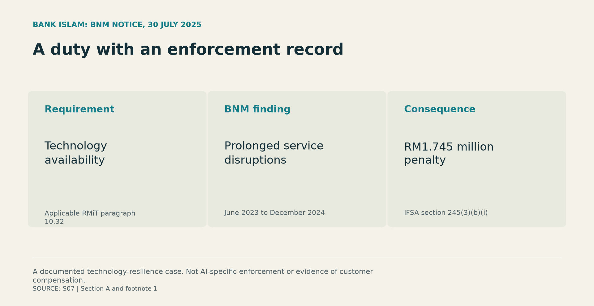
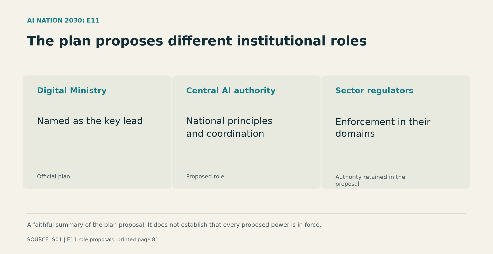
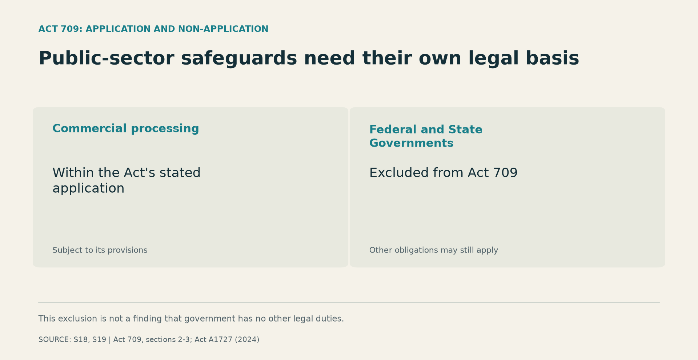

+++

title = "Does Malaysia Need Another Agency to Become an AI Nation?"
description = "Bank Islam faced a technology penalty. Malaysia’s AI plan raises the next question: who can enforce its promises, and what should change first?"
slug = "malaysia-ai-2030-authority"
article_id = "malaysia-ai-2030-authority"
genre = "essay"
date = 2026-10-25T00:00:00+08:00
lastmod = 2026-10-24T13:55:41+08:00
publishDate = 2026-10-25T00:00:00+08:00
draft = true
time_sensitive = true
author = "Meor Ajrul"
tags = ["Malaysia", "AI", "Public policy", "Government"]

[cover]
image = "hero.png"
alt = "Imagined Malaysian civic buildings connected by circuit-like paths to a public-service doorway."
caption = "Decorative AI-generated illustration of an imagined setting; not documentary evidence."
relative = true
+++

On 30 July 2025, Bank Negara Malaysia (BNM) [announced a RM1.745 million penalty against Bank Islam](https://www.bnm.gov.my/-/eapn725) for prolonged service disruptions. BNM said repeated outages between June 2023 and December 2024 had breached its technology availability requirements.

BNM’s notice named the applicable technology requirement and identified the power under the Islamic Financial Services Act that authorised the penalty.

This was a technology-resilience case, not AI enforcement. But it gives Malaysia’s AI debate a concrete starting point: **when a requirement is breached, who can act, and what can they require?**

Before creating another management body, Malaysia should publish what its existing institutions can enforce and where their powers fall short. That is the first task for AI Nation 2030; the case for an additional authority should follow the evidence of a specific gap.

*Source: [BNM notice, 30 July 2025, section A and footnote 1](https://www.bnm.gov.my/-/eapn725). The penalty is an enforcement outcome; it is not evidence of compensation to customers. Select any figure to view it at full size.*

## The plan already has a coordinating organisation

The government [announced AI Malaysia Berhad on 28 July 2026](https://www.digital.gov.my/en-GB/siaran/AI-Malaysia-Pemacu-Utama-Menuju-Negara-AI-2030), institutionalising the National AI Office. Its stated responsibilities include coordination, implementation monitoring, governance and AI safety.

The [National AI Action Plan 2026–2030](https://ai.gov.my/aiactionplan2030/flip-pdf/en.pdf) assigns AI Malaysia a central secretariat role. Its governance initiative E11 proposes central coordination while retaining enforcement with sector regulators.

A coordinating organisation is therefore already identified. Any proposal for another body should explain the additional power or capability it would supply.

*Source: [National AI Action Plan, E11, role proposals on printed page 81](https://ai.gov.my/aiactionplan2030/flip-pdf/en.pdf). The proposed central authority should not be assumed to have the same mandate or powers as AI Malaysia’s coordinating function.*

The plan is relevant because it sets out responsibilities against which government can be questioned. Its proposed roles still need to be matched to powers actually in force.

## A policy needs an identifiable source of authority

Malaysia’s [AI Code of Ethics, AICE](https://ai.gov.my/governance/ai-code-of-ethics-aice/), describes itself as voluntary and non-binding. It can state recommended practice. Its recommendations alone do not establish an offence; conduct may still breach another applicable law.

The Bank Islam notice identifies the law behind its requirement and penalty. Every claimed AI obligation needs the same clarity: who it binds, which provision authorises it and who can enforce it.

On 5 October 2026, the Digital Minister [told the Dewan Rakyat](https://hansard.parlimen.gov.my/hansard/dewan-rakyat/2026-10-05) that the AI Governance Bill was expected to be tabled in early 2027. That statement is an announced timetable. The powers created by any eventual Act must be assessed against its enacted provisions and commencement.

The announcements reviewed here do not establish general AI Malaysia powers to penalise private AI users. That is an unanswered question about its mandate, rather than proof that it has no authority. Publish the relevant laws and authorisations, then identify any missing power and the cases it leaves unresolved.

## Three changes to make accountability concrete

The immediate proposals below draw on existing Malaysian documents. They ask for specific records and decisions; their effectiveness has not been measured here.

### 1. Publish the powers, and name the officer responsible

The Digital Ministry should ask AI Malaysia to compile a public register with service-owning ministries, regulators and legal advisers. For each AI-enabled service, identify the duty, the law or administrative instrument behind it, the accountable officer, who can obtain records and require correction, and the route for challenging a decision. Mark proposed powers separately and assign unresolved jurisdiction questions to a named institution.

[Jabatan Digital Negara (JDN) already offers AI advisory support based on GPAISA](https://www.jdn.gov.my/en/ict-consulting-services/), its public-sector AI adoption guidance. [Chapter 4](https://www.jdn.gov.my/wp-content/uploads/2025/03/EDARAN_v2_Garis-Panduan-Pengadaptasian-AI-Sektor-Awam_4Mac2025.pdf) describes responsibilities for developers, deployers and civil servants. Each ministry should name the officer accountable for applying that guidance and disclose completed checks and outstanding findings, with necessary redactions. Staffing adequacy and compliance need their own evidence.

**The deliverable:** a public service-by-service register connecting each responsibility to its legal basis and accountable officer, with gaps clearly marked. Cooperation agreements must not be presented as creating statutory powers.

### 2. Give the purchasing ministry enforceable supplier commitments

Treasury, JDN and purchasing ministries should publish standard AI procurement clauses covering access to relevant records, acceptance tests, incident notification, service continuity and exit arrangements, adapted to the applicable procurement framework.

BNM’s [September 2026 Risk Management in Technology policy, paragraph 10.48](https://www.bnm.gov.my/documents/20124/938039/pd-rmit-sep26.pdf), provides a specific precedent: supplier agreements must address access, confidentiality, availability, continuity on exit and incident notification. These requirements have a financial-sector scope; they are not automatically government procurement rules. This is also a later policy version than the one applied in the 2025 Bank Islam case.

Each purchasing ministry should name the official authorised to invoke contractual remedies and record the response to a failed test or supplier non-compliance. The response must follow the signed agreement and applicable law. Existing government AI contracts were not inspected for this essay, so their adequacy remains an open question.

**The deliverable:** standard clauses and a procurement record showing the acceptance criteria, findings that can safely be disclosed, the decision to accept or require correction, and the official responsible for enforcing the agreement.

### 3. Give people a usable route to correction

A person affected by a public service needs to know where to request an explanation, correction or review. The service-owning ministry should publish that route, the applicable deadlines, the official who can obtain the records and change the decision, and the legal basis for any further review.

The government cannot simply assume that private-sector data protections supply the answer. [Section 3(1) of the Personal Data Protection Act](https://www.investmalaysia.gov.my/media/3x4fsqum/personal-data-protection-act-2010.pdf) excludes the Federal and State Governments. The [2024 Amendment Act](https://lom.agc.gov.my/ilims/upload/portal/akta/outputaktap/2430673_BI/Act%20A1727.pdf) does not remove that exclusion. Other obligations may still apply, and the exclusion should not be extended to every government-linked organisation.

*Sources: [Act 709, sections 2 and 3, 2023 reprint](https://www.investmalaysia.gov.my/media/3x4fsqum/personal-data-protection-act-2010.pdf), read with the [2024 Amendment Act](https://lom.agc.gov.my/ilims/upload/portal/akta/outputaktap/2430673_BI/Act%20A1727.pdf). This distinction does not establish the absence of other public-sector safeguards.*

Each ministry should identify the protections that apply to its service. Label an internal complaint commitment accurately. A claim of independent or statutory review should name the institution and provision that make it available. Record a missing remedy as a gap requiring action.

**The deliverable:** a published review route identifying who can reconsider the decision, under what authority, and where to go next, supported by privacy-protected records of cases reviewed, decisions corrected and unresolved complaints.

## Show whether the programme is working

AI Malaysia and delivery ministries should distinguish announcements and deployment counts from evaluated results. Before expanding a service, publish the evaluation, unresolved findings and the decision authorising continuation. A claim of improvement needs an observed baseline and comparison method. Regulators should separately report enforcement within their mandates. Define each measure and its reference period: a penalty, a stopped breach and a corrected individual decision describe different outcomes.

## What another agency would need to prove

A proposal for another authority should bring evidence of the gap it is meant to close: unresolved cases, a missing legal power or a documented shortage of specialist capability. It should explain why strengthening an existing institution would be insufficient and specify the proposed body’s powers, resources, limits and review arrangements.

The evidence reviewed here leaves that institutional comparison open. Until it is made, government should clarify and account for the powers already assigned.

Bank Islam’s case supplies an identifiable breach and a reported enforcement consequence. Malaysia’s AI programme should be held to the same demand for specificity: **who owes the duty, who can act, and what happened when they did?**

The next agency proposal should answer those questions. The institutions already responsible for the plan should answer them too.

---

*Evidence reviewed on 23 October 2026. The parliamentary transcript is marked draft; the Bill timetable remains an expectation. The linked Act 709 reprint is dated July 2023 and is read here alongside the 2024 Amendment Act for the scope distinction discussed. This essay does not provide a complete audit of operative powers or policy effectiveness. Recommendations remain for author review.*
