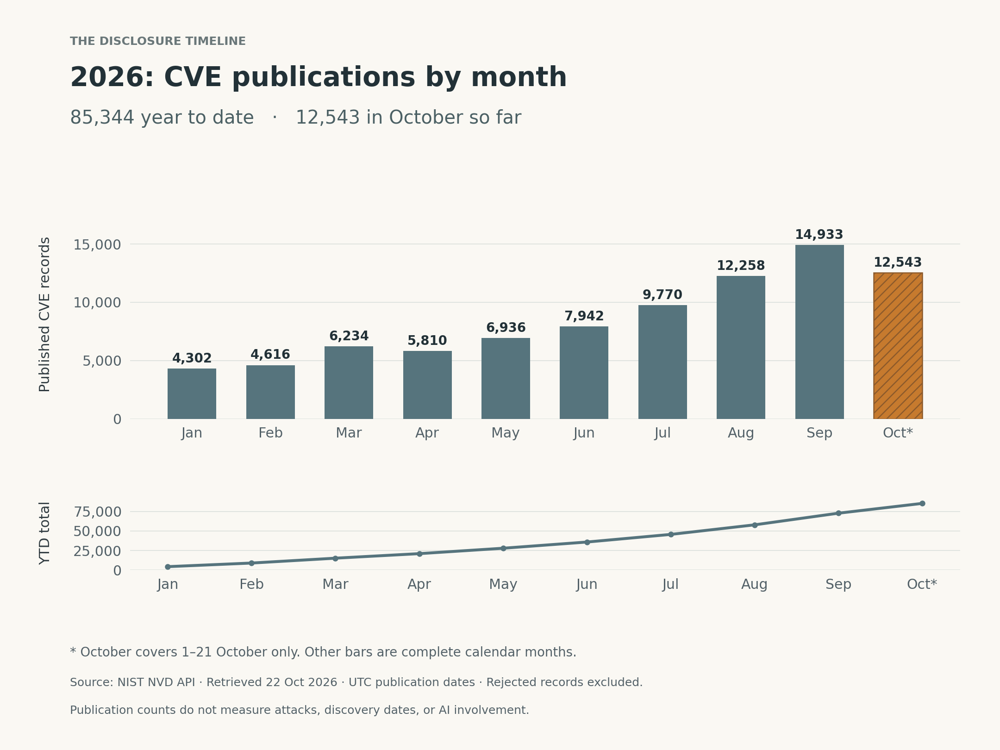
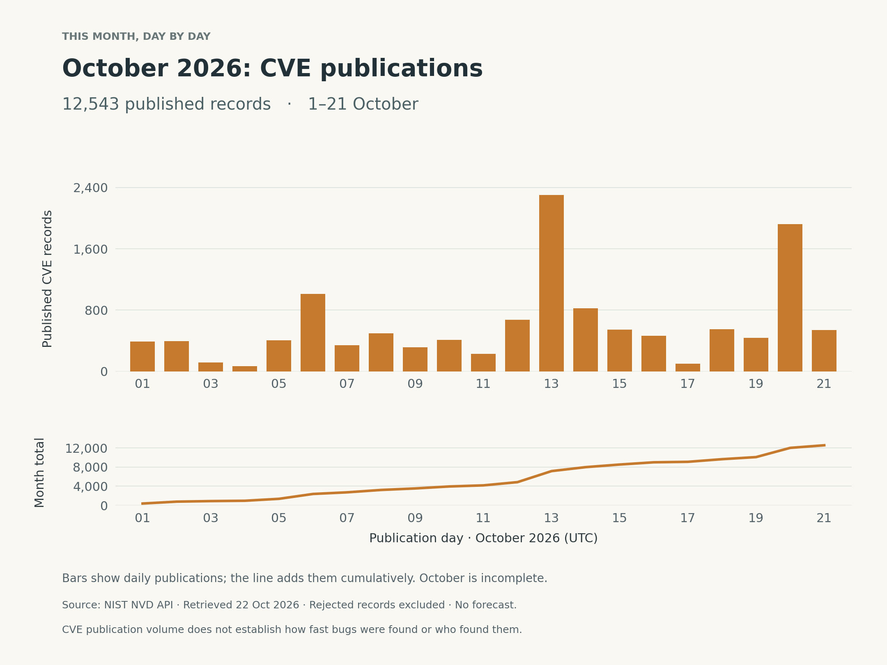

+++
title = "We Already Had the Warning"
description = "From Mythos to PHP, Node.js and other framework vulnerabilities: why I favour preventive hardening, with CVE publication timelines for October and 2026 so far."
slug = "php-ai-security-hardening"
article_id = "php-ai-security-hardening"
genre = "essay"
date = 2026-10-22T00:00:00+08:00
draft = false
time_sensitive = true
author = "Meor Ajrul"
tags = ["software", "security", "AI"]
[cover]
image = "hero-v2.png"
alt = "An orange-lit digital bug breaks into the teal wireframe membrane of a luminous digital cell."
caption = "AI-generated illustration of a digital bug attacking a digital cell; a symbolic security metaphor."
relative = true
hidden = false
+++

The recent PHP vulnerabilities brought back the warning we already had when Claude Mythos was introduced.

My view is simple: take the preventive route. Review the systems we depend on, harden what we deploy, and prepare to apply fixes promptly. Waiting to see whether an attack reaches us is an approach I would rather avoid.

## The warning before PHP

When Anthropic introduced Claude Mythos Preview in April 2026, it reported that the model could find serious software vulnerabilities and develop working exploits. Its researchers described cases where engineers requested a vulnerability search overnight and had a working exploit by morning. Initial access was restricted through Project Glasswing so selected organizations could use it for defensive work. These were Anthropic’s reported results, with the limitations of a vendor’s own evaluation. [Anthropic’s Mythos research](https://www.anthropic.com/research/mythos-preview).

The release history also deserves a clear account. Mythos Preview was held back from general availability at introduction. Later, in June, Anthropic suspended access to Mythos 5 and Fable 5 following a US export-control directive. Access was subsequently restored, with Mythos initially returning to a set of approved US organizations. Restricted introduction, suspension, and restoration were separate stages. [Anthropic’s account](https://www.anthropic.com/news/redeploying-fable-5).

For me, the important point is that the warning was already there. AI-assisted security research had demonstrated capabilities that deserved attention before this PHP announcement.

## Now the reminder is concrete

On 21 October 2026, PHP released fixes for two critical vulnerabilities: **CVE-2026-109618 and CVE-2026-109619**. Both can allow remote code execution without authentication. The PHP project urges users to update and explicitly warns that temporary mitigations are incomplete. [PHP security advisory](https://www.php.net/archive/2026.php#2026-10-21-5).

Node.js published security releases on the same day. They addressed several vulnerabilities, including **CVE-2026-111497**, a high-severity Brotli decoder flaw that can permit remote code execution. [Node.js security release](https://nodejs.org/en/blog/vulnerability/october-2026-security-releases).

**Update, 24 October 2026:** PHP published a further [session upload progress advisory on 23 October](https://www.php.net/archive/2026.php). It describes an additional remote-code-execution path under an unusual combination of session configuration and application behaviour. Check that follow-up as well as the original patch advisory when assessing an installation.

## PHP is one part of a wider problem

PHP is a language and runtime; Node.js is a JavaScript runtime. Frameworks and the components they depend on have their own security advisories too. Here are three examples from other ecosystems:

| Framework or component | Advisory date | Example CVE | What the advisory describes |
| --- | --- | --- | --- |
| **Django — Python web framework** | 6 October 2026 | **CVE-2026-84429** | A potential denial of service in HTTP header parsing. An unauthenticated request could reach the affected parser through certain headers; Django rated the issue moderate. [Django advisory](https://www.djangoproject.com/weblog/2026/oct/06/security-releases/). |
| **Spring Security — Java ecosystem security component** | 20 August 2026 | **CVE-2026-41707** | A high-severity proof-replay vulnerability in its DPoP implementation. It requires an attacker to intercept a valid proof and force its identifier out of the replay-protection cache, potentially allowing impersonation. [Spring advisory](https://spring.io/security/cve-2026-41707/). |
| **React Server Components — used by frameworks including Next.js** | 3 December 2025 | **CVE-2025-55182** | Unauthenticated remote code execution in affected server-component packages. The React advisory excludes client-only applications and applications without tooling that supports React Server Components. [React advisory](https://react.dev/blog/2025/12/03/critical-security-vulnerability-in-react-server-components). |

These are selected examples from different dates, with different impacts and conditions. They show that vulnerability management belongs across the software stack. A few advisories cannot rank the relative security of these technologies, and a CVE does not mean every application using that technology is exposed.

For me, the practical point is straightforward: a PHP warning should prompt us to review the rest of our dependencies too. Teams using Python, Java, or JavaScript need to follow the advisories relevant to their own deployed versions and features.

These advisories do not establish that AI discovered the listed flaws. Likewise, they do not tell us exactly how quickly future CVEs will appear. The AI-assisted research discussed earlier provides a reason to take preparation seriously; the framework advisories show that the maintenance work already extends beyond PHP.

## What the publication timeline shows

The broader record gives some scale to the maintenance work. In the [NIST National Vulnerability Database API](https://services.nvd.nist.gov/rest/json/cves/2.0) snapshot retrieved on 22 October, **85,344 CVE records** had publication dates from **1 January through 21 October 2026**, excluding rejected records. **12,543** were published during **1–21 October**.

*Monthly publications and cumulative YTD totals. October is incomplete; it should not be compared as a full month. [Data](cve-monthly-2026.csv) · [PDF](cve-ytd-2026.pdf).*

*Daily publications and cumulative October totals, using complete UTC days. [Data](cve-daily-october-2026.csv) · [PDF](cve-october-2026.pdf) · [Full data, accessible tables and method](cve-data-methods.txt).*

These are publication counts across the NVD, including software and hardware. They do not tell us when each bug was discovered, how many attacks occurred, or whether AI found it. The charts supply context for the work of reviewing disclosures; they do not establish that AI caused a change in volume.

## Finding the problem is only part of the work

The PHP Foundation’s account adds another important detail. Early signs of one problem emerged during human audit follow-up in 2024. Work on a fix stalled amid compatibility tradeoffs, limited resources, and difficulties making decisions. Later reports clarified the remote code execution impact. [PHP Foundation’s account](https://thephp.foundation/blog/2026/10/21/todays-php-security-release-and-how-were-strengthening-php-security/).

That is a reminder to look beyond the discovery tool.

Once a finding reaches our team, who investigates it? Who checks whether our deployment is affected? Who has the authority to prioritize the fix? Who verifies that the corrected software is actually running?

These are questions I want answered before the next urgent advisory arrives.

## Take the preventive route

For the current PHP incident, ENISA recommends identifying affected applications, coordinating with service providers, prioritizing exposed systems, and considering isolation where immediate remediation is not feasible. It also warns that PHP may sit inside third-party products without being obvious to their users. [ENISA’s guidance](https://www.enisa.europa.eu/news/joint-statement-on-critical-php-vulnerabilities).

Beyond the immediate patch, hardening deserves regular attention. For container deployments, that includes reviewing privileges, capabilities, and writable filesystems against established guidance. [OWASP’s Docker security guidance](https://cheatsheetseries.owasp.org/cheatsheets/Docker_Security_Cheat_Sheet.html).

My position is that we should make this work routine: know what we run, follow its security advisories, test updates, limit unnecessary access, and assign responsibility for following through.

We already had the warning with Mythos. The PHP and Node.js releases give us concrete work to do now.

*Originally based on advisories and data inspected on 22 October 2026. Cited advisory passages rechecked on 24 October; the CVE publication charts retain the 22 October snapshot.*
