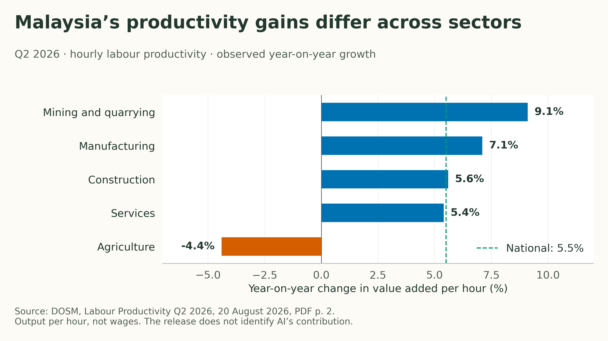
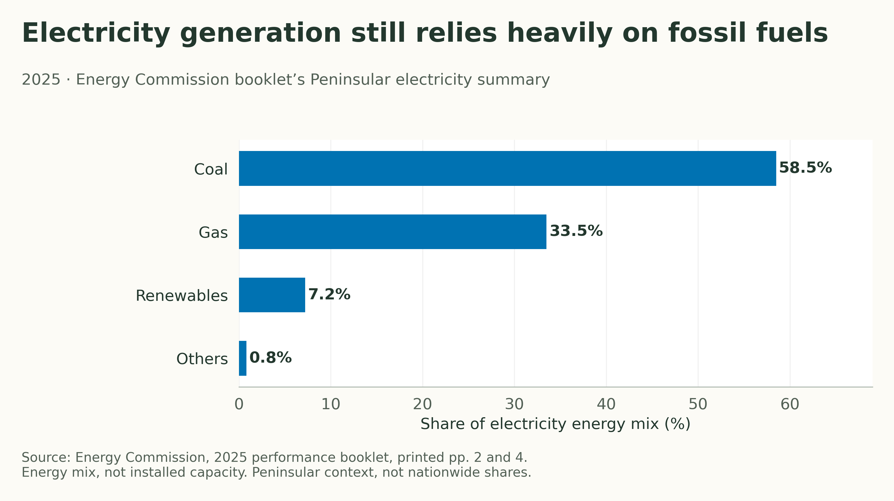
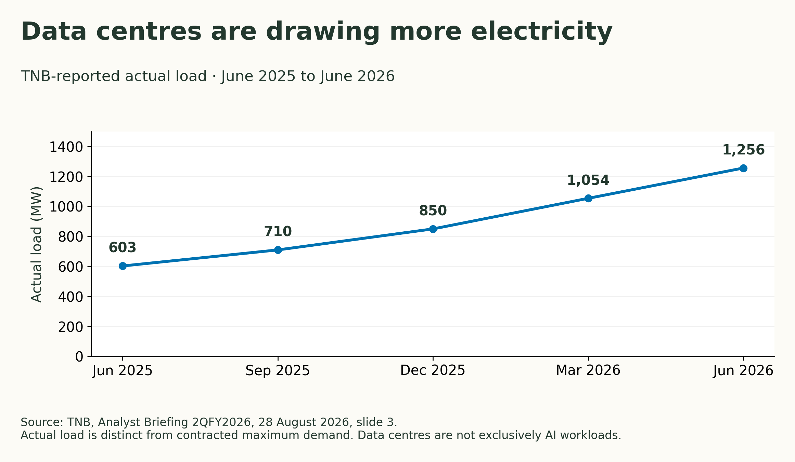
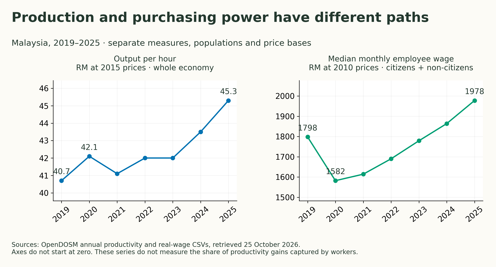
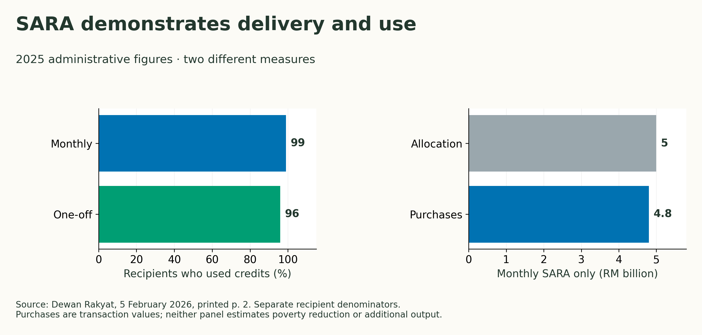

+++
title = "Can Malaysia Create—and Share—AI Abundance?"
description = "Malaysia’s productivity, real wages, household costs and electricity data test the promise of AI abundance and universal high income."
slug = "universal-high-income"
article_id = "universal-high-income"
genre = "essay"
date = 2026-10-26T09:00:00+08:00
publishDate = 2026-10-26T09:00:00+08:00
draft = true
time_sensitive = true
author = "Meor Ajrul"
tags = ["AI", "Malaysia", "Work", "Income", "Public policy"]

[cover]
image = "hero.png"
alt = "AI-generated editorial still life of a mechanical gripper beside stacked coins and an open blank notebook."
caption = "AI-generated editorial still life; decorative imagery, not documentary evidence."
relative = true
+++

Malaysia can already send assistance to millions of people. Can it also create enough new value to make everyday life more affordable—and give everyone a dependable share?

That is the question behind universal high income. Here, abundance means being able to obtain more of what people need and value. There is no assumed payment amount or arrival date.

Malaysia’s data offers three parts of an answer: the country is producing more per hour; real median wages have recovered, though household costs still matter; and assistance programmes have demonstrated wide use. What the evidence cannot yet establish is how much additional wealth AI creates, or how much could reach every household year after year.

## 1. Malaysia has productive capacity. AI’s added value is harder to measure.

A useful starting point is what Malaysia already produces. [DOSM’s annual data](https://open.dosm.gov.my/data-catalogue/productivity_annual) puts output per hour at RM 40.7 in 2019 and RM 45.3 in 2025, measured at constant 2015 prices. The series also shows pauses and reversals. These are the revised figures in the current data download.

The [Q2 2026 release](https://www.dosm.gov.my/uploads/release-content/file_20260820111723.pdf) provides a more recent snapshot: output per hour reached RM 46.5, up 5.5% from a year earlier. Output grew 6.0%, while hours worked grew 0.5%. Malaysia produced more for each hour worked. These national figures do not tell us how much of that improvement came from AI.

*Year-on-year changes. Source: DOSM, 20 August 2026. National reference 5.5%; this measures output, not wages. [Data](productivity-q2-2026.csv) · [PDF](productivity-q2-2026.pdf).*

Manufacturing and services improved, while agriculture’s hourly productivity fell. The national gain was not shared by every sector.

### What MPC found about AI

The [Malaysia Productivity Corporation’s 2026 report](https://irp.cdn-website.com/d9b8bd4d/files/uploaded/02.+MPC_APR2026_Website+.pdf) examined 57 manufacturers involved in digital and AI transformation programmes. Firms spending more on AI-related investment did not show a statistically reliable productivity advantage in that selected sample. That limits what this study can tell us about the return on AI spending. It does not prove that AI has no value.[^mpc]

A separate MPC readiness summary reports 72.9% of firms seeing improved outcomes, with 29.7% reporting high AI readiness. Its sample size and fieldwork period are unstated. Reported improvements in compliance, customer engagement and innovation should not be counted as measured national output gains.

To study the national picture, MPC uses investment in intellectual property, including software and research, as a broad stand-in for technology investment. The report cautions that its association with productivity is neither AI-specific nor causal. Better measurement is still needed before assigning a national dividend to AI.

Malaysia also has operating AI infrastructure. [YTL AI Cloud reported in May 2026](https://www.ytlaicloud.com/press-releases/ytl-ai-cloud-among-asias-first-cloud-providers-to-achieve-nvidia-exemplar-cloud-status/) that its Johor infrastructure achieved NVIDIA Exemplar Cloud status after benchmarking a 512-GPU environment. The provider’s report supports that specific technical achievement. It does not measure total Malaysian computing capacity, utilisation or affordable access for local firms.

[^mpc]: MPC, printed pp. 87–89. The selected 57-firm relationship has R²=0.003 and p=0.664. The low explanatory power and lack of statistical significance do not establish a causal effect or absence of one.

### The electricity test

The [Energy Commission’s 2025 performance booklet](https://www.st.gov.my/sites/default/files/2026-04/ST_Performance-Booklet_Digital_FA_Hi-Res.pdf) records 28,192 MW of transmission-connected capacity and peak demand of 21,049 MW in Peninsular Malaysia. Its electricity summary remains dominated by coal and gas.

*Source: Energy Commission 2025 booklet, printed pp. 2 and 4. Peninsular context; energy shares, not installed-capacity shares or nationwide totals. [Data](electricity-mix-2025.csv) · [PDF](electricity-mix-2025.pdf).*

Data centres are already drawing power from the grid. [TNB’s August 2026 briefing](https://www.tnb.com.my/assets/quarterly_results/Analyst_Briefing_-_2QFY2026.pdf) records 42 data-centre projects in its system by June, with 5.65 GW of maximum demand. Actual data-centre load was 1,256 MW in June 2026, compared with 603 MW a year earlier. The full secured pipeline was 61 projects with 8.35 GW, including construction and agreement stages.

*Source: TNB 2QFY2026 briefing, slide 3. Actual load; excludes unbuilt pipeline capacity. Data centres are not exclusively AI workloads. [Data](data-centre-load.csv) · [PDF](data-centre-load.pdf).*

The difference between contracted maximum demand and actual load is not automatically spare capacity available to another customer. The briefing does not provide a site-level connection queue, waiting-time distribution or a measure of how much capacity can be reassigned. TNB also reports distribution interruption duration of 23.45 minutes in the first half of 2026; a system average cannot guarantee service at a particular site.

Electricity prices need equally careful reading. The [tariff framework effective from July 2025](https://www.st.gov.my/ms/node/766) set an **average base tariff of 45.40 sen/kWh**. This is a regulatory average, not a data centre’s all-in electricity price. Bills distinguish energy, capacity, network and retail charges, while the Automatic Fuel Adjustment mechanism responds to fuel prices and exchange rates each month.

Malaysia has electricity supply serving operating data centres, and rules for charging for it. That does not establish cheap power for everyone or unlimited new connections. A project’s actual costs and access still depend on its tariff, pattern of electricity use and connection terms.

## 2. More output matters to households when purchasing power improves.

Producing more per hour answers part of the abundance question. The next part is whether people can buy more with their earnings. There is evidence of improvement here too. [DOSM’s real-wage series](https://open.dosm.gov.my/data-catalogue/wages_real_state) reports median monthly wages of RM 1,798 in 2019, RM 1,582 in 2020 and RM 1,978 in 2025, all at 2010 prices. This series includes citizen and non-citizen employees. The recovery matters: a nominal pay rise alone would not establish greater purchasing power.

*Sources: OpenDOSM CSVs retrieved 25 October 2026. Separate scales and populations; no wage-share or causal inference. Wage series includes non-citizens; productivity covers the whole economy. [Data](production-and-real-wages.csv) · [PDF](production-and-real-wages.pdf).*

Each series describes a population at successive dates; it does not follow the same workers over time. The two panels also use different units, price bases and populations. Their lines cannot show how much of the productivity gain went to workers.

Household income answers another part of the question. [Median gross monthly income for citizen households](https://open.dosm.gov.my/data-catalogue/hh_income) rose from RM 6,338 in 2022 to RM 7,017 in 2024. These are nominal household totals, including sources beyond wages. They cannot be compared directly with an individual salary or treated as money left after taxes and essential spending.

The cost of essentials still matters. [DOSM’s 2025 consumer-price report](https://www.dosm.gov.my/uploads/release-content/file_20260429112321.pdf) records overall inflation of 1.4%, food and beverages 2.1%, and food away from home 4.0%; food at home rose 0.1%. These national averages conceal different spending patterns. Slower price increases also leave the earlier price level in place.

The median employee wage bought more in 2025 than in 2019, according to this series. But prices continued to rise, and households faced different circumstances. These figures neither attribute the improvement to AI nor establish that everyone can comfortably afford essentials.

## 3. Malaysia can distribute assistance. A lasting AI dividend still needs funding.

Malaysia’s existing programmes give us evidence about delivering support. [STR](https://www.mof.gov.my/portal/ms/berita/akhbar/5-3-juta-penerima-str-mula-terima-bayaran-secara-berperingkat-mulai-hari-ini-mof) uses bank payments and BSN cash collection, while [SARA](https://www.sara.gov.my/en/home.html) provides MyKad-linked credits for approved essentials. The latter is restricted purchasing support, not unrestricted cash.

A [February 2026 parliamentary response](https://www.parlimen.gov.my/files/hindex/pdf/DR-05022026.pdf) reported that 99% of monthly SARA recipients and 96% of one-off recipients used their credits in 2025. It also reported RM 4.8 billion of monthly SARA purchases against a RM 5 billion allocation.

*Source: Dewan Rakyat, 5 February 2026, printed p. 2. Separate recipient denominators; transaction totals do not measure added output or poverty effects. [Data](sara-delivery.csv) · [PDF](sara-delivery.pdf).*

The programmes have also reached beyond targeted recipients: the [February 2026 SARA Untuk Semua announcement](https://mof.gov.my/portal/ms/berita/siaran-media/sara-untuk-semua-disalurkan-mulai-9-februari-2026) allocated RM 2.2 billion for a one-off RM 100 credit to more than 22 million adult citizens. Reliability still matters. [MOF acknowledged terminal degradation](https://www.mof.gov.my/portal/ms/berita/siaran-media/850-ribu-penerima-penghargaan-sara-belanja-lebih-rm50-juta-pada-hari-pertama) during the 31 August 2025 transaction surge. High eventual usage does not measure people excluded from the register or guarantee uninterrupted access.

The [2026 STR/SARA allocation of RM 15 billion](https://www.mof.gov.my/portal/ms/berita/akhbar/5-3-juta-penerima-str-mula-terima-bayaran-secara-berperingkat-mulai-hari-ini-mof) and [RM 16 billion announced for 2027](https://www.mof.gov.my/portal/ms/berita/ucapan/ucapan-belanjawan-madani-kelima-tahun-2027) show spending commitments, with different programme designs. Neither is AI-generated revenue. The [OECD’s 2026 survey](https://www.oecd.org/en/publications/oecd-economic-surveys-malaysia-2026_9ab6b826-en.html) calls for better spending efficiency and additional revenue to improve social protection and education. The payment channels are real. The recurring AI revenue that could fund a universal dividend has not been established.

### What other countries can tell us

[OpenResearch’s US experiment](https://www.openresearchlab.org/projects/unconditional-cash-study) compared 1,000 adults receiving US$1,000 monthly with 2,000 receiving US$50 during 2020–2023. The team reports modest work reductions alongside improvements in planning and agency. The selected population and temporary transfers limit what it says about permanent national support.

The [Kenyan cash-transfer experiment](https://economics.yale.edu/sites/default/files/cash_transfers_ge_ada-ns.pdf) found consumption gains, spillovers and minimal local price inflation in its 2014–2017 study setting. The inspected 2019 working paper concerns externally funded, one-time transfers. It does not settle inflation under permanent national high income.

[Alaska’s Permanent Fund](https://apfc.org/the-fund/fund-structure/) demonstrates an institution linking investment earnings to public services and resident dividends. Its resource revenues and accumulated assets do not supply an estimate of what Malaysia could distribute from AI.

These examples show what has been studied or built elsewhere. None supplies the missing Malaysian figures for AI-generated output or public revenue. Similarly, the [ILO’s AI exposure research](https://www.ilo.org/resource/article/how-might-generative-ai-impact-different-occupations) measures potential task exposure rather than observed job losses, while the [IMF’s fiscal discussion](https://www.imf.org/en/blogs/articles/2024/06/17/fiscal-policy-can-help-broaden-the-gains-of-ai-to-humanity) examines policy responses rather than a funded universal-income programme.

### Where that leaves Malaysia

Malaysia has something to build on: measured productivity gains, recovering real median wages, operating computing infrastructure and widely used assistance programmes.

The abundance question comes back to those same three tests. How much extra value does AI create? Do households gain purchasing power? Is there recurring revenue to share? The reviewed evidence does not yet support a universal payment amount or a start date.

**Malaysia has the capacity to produce more and experience delivering support. Whether AI can make a dependable, widely shared abundance possible remains an open question.**
