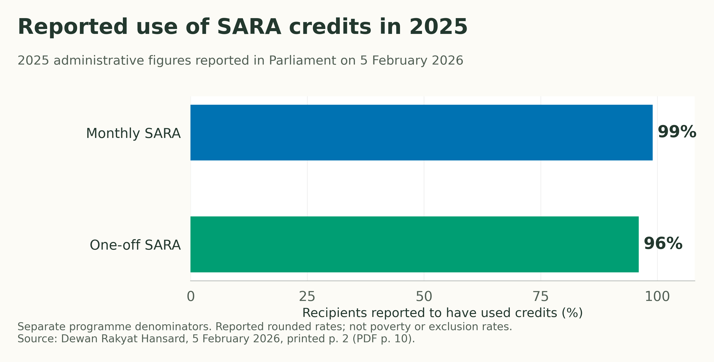
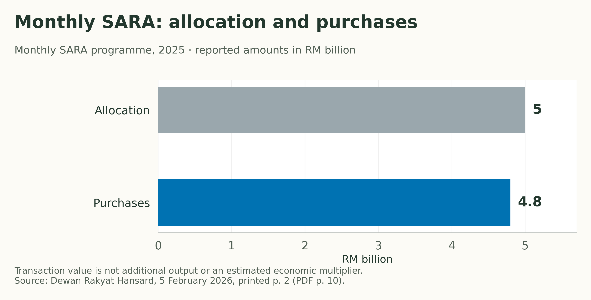
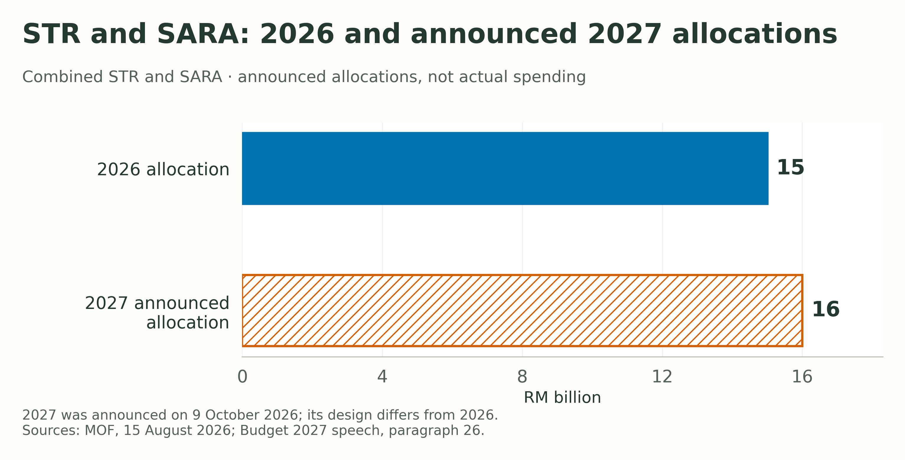

+++
title = "Universal High Income: Who Gets the AI Dividend?"
description = "Malaysia’s productivity, AI and electricity data show real capabilities. Do they establish abundance—or the means to share an AI dividend?"
slug = "universal-high-income"
article_id = "universal-high-income"
genre = "essay"
date = 2026-10-26T09:00:00+08:00
publishDate = 2026-10-26T09:00:00+08:00
draft = true
time_sensitive = true
author = "Meor Ajrul"
tags = ["AI", "Malaysia", "Work", "Income", "Public policy"]

[cover]
image = "hero.png"
alt = "AI-generated editorial still life of a mechanical gripper beside stacked coins and an open blank notebook."
caption = "AI-generated editorial still life; decorative imagery, not documentary evidence."
relative = true
+++

If AI does more of the work, who receives the income?

That question sits behind the promise of universal high income. The attraction is easy to understand: a comfortable life without having to depend entirely on wages. The harder question is what evidence supports the promise.

At Davos in January 2026, Elon Musk described AI and robotics as a route to global abundance. The [World Economic Forum’s account of the discussion](https://www.weforum.org/stories/artificial-intelligence/elon-musk-technology-abundant-future-davos-2026) also records his concern about electricity constraints. It establishes what he argued. It does not establish that an economy providing everyone with a high income has been demonstrated.

There is useful evidence nearby: experiments with unconditional cash, an operating public-dividend institution and research on AI’s effects on work. Each answers a narrower question.

## Malaysia already has part of the delivery capability

Malaysia would not be starting from zero. STR and SARA already perform relevant functions, although they provide different kinds of support. [STR payments](https://www.mof.gov.my/portal/ms/berita/akhbar/5-3-juta-penerima-str-mula-terima-bayaran-secara-berperingkat-mulai-hari-ini-mof) go into bank accounts, with cash collection through Bank Simpanan Nasional for recipients without an account. [SARA](https://www.sara.gov.my/en/home.html) uses MyKad-linked accounts for purchases of approved essentials at participating retailers. Those credits are not unrestricted cash.

There is also experience with broad adult eligibility. The [February 2026 SARA Untuk Semua announcement](https://mof.gov.my/portal/ms/berita/siaran-media/sara-untuk-semua-disalurkan-mulai-9-februari-2026) provided RM100 once, with RM2.2 billion allocated for more than 22 million adult Malaysian citizens. This was a one-off essentials credit, not a recurring high income.

What happened when the system was used? In a [ministerial response recorded in Parliament on 5 February 2026](https://www.parlimen.gov.my/files/hindex/pdf/DR-05022026.pdf), the government reported that 99% of monthly SARA recipients had used the programme in 2025, compared with 96% of recipients of the one-off SARA payment. The figures refer to each programme’s own recipients.

*Reported administrative use, not a poverty-reduction estimate or a measure of eligible people excluded from the register. Source: the parliamentary response linked above. [Data](sara-usage-2025.csv) · [PDF](sara-usage-2025.pdf).*

The same response reported RM4.8 billion in monthly SARA purchases against a RM5 billion allocation for 2025. These are recorded programme purchases and a stated allocation; they are not an estimate of additional economic output.

*2025 monthly SARA only; excludes the separate one-off programme. This does not measure a fiscal multiplier or establish lasting improvements in living standards. [Data](sara-monthly-spending-2025.csv) · [PDF](sara-monthly-spending-2025.pdf).*

This gives a more grounded answer to the Malaysian question: there is demonstrated experience in distributing assistance and enabling purchases. Reusing that experience for a future dividend is worth investigating. Its suitability for a permanent universal high income has not been tested by these figures.

## Reach is real; reliability and funding still need scrutiny

The record includes a warning about scale. On [31 August 2025, MOF acknowledged degraded terminal performance at some locations](https://www.mof.gov.my/portal/ms/berita/siaran-media/850-ribu-penerima-penghargaan-sara-belanja-lebih-rm50-juta-pada-hari-pertama) after a surge in SARA transactions, and announced capacity work and maintenance. High eventual usage should not erase that incident. Neither source supplies a complete, independently audited measure of uptime or of people unable to access their entitlement.

Funding is a separate unresolved question. The [2026 STR/SARA allocation was RM15 billion](https://www.mof.gov.my/portal/ms/berita/akhbar/5-3-juta-penerima-str-mula-terima-bayaran-secara-berperingkat-mulai-hari-ini-mof). The [Budget 2027 speech, presented on 9 October 2026](https://www.mof.gov.my/portal/ms/berita/ucapan/ucapan-belanjawan-madani-kelima-tahun-2027), announced RM16 billion for 2027, alongside changes to the programme’s design.

*Allocations, not actual expenditure or AI-generated revenue. Programme design differs between years; the comparison does not measure equal benefits per person. [Data](str-sara-allocations.csv) · [PDF](str-sara-allocations.pdf).*

A larger assistance budget establishes a spending commitment. It does not demonstrate a recurring AI surplus sufficient to finance universal high income. The [OECD’s 2026 Malaysia survey](https://www.oecd.org/en/publications/oecd-economic-surveys-malaysia-2026_9ab6b826-en.html) calls for both more efficient spending and additional revenue to improve social protection and education. That assessment supplies a fiscal constraint to examine, rather than a costed answer to this article’s question.

Malaysia’s existing programmes therefore provide evidence for a delivery foundation. Delivery records alone do not establish the productive capacity, affordable essential supplies or recurring revenue required for abundance. The production evidence needs a separate examination. They also do not show how much a universal payment could sustainably provide. Those questions remain open.

## Can Malaysia produce more, beyond distributing assistance?

There is evidence that it can. [DOSM’s latest productivity release, published on 20 August 2026](https://www.dosm.gov.my/uploads/release-content/file_20260820111723.pdf), records value added per hour worked of RM46.5 in the second quarter of 2026, up 5.5% from a year earlier. Economic output grew 6.0% while hours worked grew 0.5%. That is measured output growth outpacing additional working time, rather than a forecast of future abundance.

The gains were uneven. Manufacturing’s hourly productivity rose 7.1% and services’ rose 5.4%, while agriculture’s fell 4.4%.

*Year-on-year changes in value added per hour, not wages or AI-attributable gains. Source: DOSM, Q2 2026 release. [Data](productivity-q2-2026.csv) · [PDF](productivity-q2-2026.pdf).*

These results establish productive progress. They do not identify how much AI contributed, or show that every household received a corresponding improvement in purchasing power. Output per hour is an economy’s production measure, not an individual worker’s pay rate.

## What MPC actually found about AI

The [Malaysia Productivity Corporation’s Productivity Report 2026](https://irp.cdn-website.com/d9b8bd4d/files/uploaded/02.+MPC_APR2026_Website+.pdf) provides a useful check on the AI claim. Its analysis of 57 manufacturers participating in digital and AI transformation programmes found a weak, statistically insignificant relationship between AI-related investment and labour productivity: R² = 0.003, p = 0.664. This selected sample does not establish that AI is ineffective; it does not demonstrate a general productivity payoff either.

A separate readiness summary reports 72.9% of firms seeing improved outcomes, but only 29.7% reporting high AI readiness. The report does not state that summary’s sample size or fieldwork period. Self-reported improvements, concentrated in compliance, customer engagement and innovation, are not a measured national output gain.

MPC also uses intellectual-property investment as a national proxy for AI-related spending over 2005–2024. It includes software, research and other assets; the report explicitly cautions against interpreting the association as AI-specific or causal. These results do not quantify an abundance forecast.

There is also tangible computing infrastructure. [YTL AI Cloud reported in May 2026](https://www.ytlaicloud.com/press-releases/ytl-ai-cloud-among-asias-first-cloud-providers-to-achieve-nvidia-exemplar-cloud-status/) that its Johor infrastructure achieved NVIDIA Exemplar Cloud status after benchmarking a 512-GPU environment. This is a provider’s report of infrastructure validation, not an independently audited estimate of national AI capacity, utilisation, affordable access for Malaysian firms or productivity gains. It nevertheless supplies a more concrete capability indicator than an announced investment total.

## Electricity exists; abundant cheap energy is a further claim

The [Energy Commission’s 2025 performance booklet](https://www.st.gov.my/sites/default/files/2026-04/ST_Performance-Booklet_Digital_FA_Hi-Res.pdf) records 28,192 MW of transmission-connected installed capacity and peak demand of 21,049 MW in Peninsular Malaysia. Its year-in-review records the commissioning of the 1,200 MW Pulau Indah gas plant. Malaysia can build and operate substantial generation infrastructure.

The energy mix also matters. The booklet reports coal at 58.5%, gas at 33.5%, renewables at 7.2% and other sources at 0.8% in its 2025 electricity summary.

*Energy mix from the booklet’s Peninsular electricity summary; not the nationwide mix or installed-capacity shares. [Data](electricity-mix-2025.csv) · [PDF](electricity-mix-2025.pdf).*

Installed megawatts are not a measurement of electricity available to a particular data centre around the clock. The booklet does not establish unlimited grid connections or low future prices. Its predominantly coal-and-gas energy mix also prevents treating current computing capacity as evidence of an already clean-energy abundance.

Taken together, these records show a productive base, recent efficiency gains and specific AI computing capability. They leave the size of a sustained AI-driven surplus unmeasured. They also do not establish how that surplus would reach households. Malaysia has evidence to build on; a claim that it can already fund universal high income runs ahead of it.

## What happens when people receive cash?

[OpenResearch’s US study](https://www.openresearchlab.org/projects/unconditional-cash-study) randomly assigned 1,000 adults to receive US$1,000 a month and 2,000 to receive US$50 a month. Transfers ran from 2020 to 2023 in Illinois and Texas. Participants were aged 21–40 and came from households with incomes at or below 300% of the federal poverty level.

The study team reports modest reductions in employment and working hours relative to the comparison group. It also reports improvements in budgeting and planning, and greater interest in education and entrepreneurship. These findings deserve to be read together. Extra income changed some choices; the evidence does not support a simple story in which everyone either stopped working or became an entrepreneur.

This was a temporary programme for a selected population. It did not test a permanent national income funded through taxes on that same economy. Nor did it test life after the disappearance of paid work. The study’s results should inform the discussion without being asked to settle those questions.

## Does extra cash just raise prices?

A [cash-transfer experiment in rural Kenya](https://economics.yale.edu/sites/default/files/cash_transfers_ge_ada-ns.pdf) offers a useful counterpoint. Transfers and data collection took place from mid-2014 to early 2017. The inspected November 2019 working paper reports increased consumption and assets among recipients, benefits extending to other households and firms, and minimal local price inflation.

That challenges the blanket claim that cash assistance simply disappears into higher prices. Its limits matter too: the transfers were one-time payments financed from outside the study area. The paper discusses available productive capacity as an interpretation of the response, rather than something to assume in every economy. A local experiment cannot establish the inflation consequences of a permanent national high-income programme.

The evidence leaves the larger question open. It gives a reason to examine actual supply conditions and financing, rather than treating either inflation or its absence as automatic.

## A dividend is already possible—but at what scale?

Alaska provides an existing institution to examine. The [Alaska Permanent Fund Corporation](https://apfc.org/the-fund/fund-structure/) explains how investment earnings support public services and the resident dividend programme. The fund has protected principal and a separate earnings account available for appropriation.

This establishes that public investment earnings can be connected to payments to residents. It does not establish that an AI fund would produce sufficient returns to provide a high income. Alaska’s resource revenues, accumulated assets and rules are specific to that institution.

The distinction is useful: there is an operating example of sharing investment earnings, while the amount another system could reliably distribute remains a separate evidence question. Calling something an “AI dividend” does not answer it.

## What has AI research actually measured?

The [ILO’s May 2025 occupational analysis](https://www.ilo.org/resource/article/how-might-generative-ai-impact-different-occupations) estimates potential exposure to generative AI. It explicitly distinguishes exposure from actual employment effects and identifies barriers to adoption. Its assessment points more towards job transformation than the complete automation of occupations with current GenAI.

That does not disprove future technological breakthroughs. It does mean these estimates cannot be presented as evidence that all paid work is about to disappear—or that the revenue for universal high income has already been established.

The [IMF’s June 2024 fiscal-policy discussion](https://www.imf.org/en/blogs/articles/2024/06/17/fiscal-policy-can-help-broaden-the-gains-of-ai-to-humanity) addresses social protection, worker transitions and taxation of capital income. These are policy responses to potential gains and disruption. They are not a demonstrated funding package for universal high income.

For Malaysia, assistance programmes establish delivery experience, while productivity and infrastructure records establish productive capabilities. Neither yet establishes an affordable universal high-income payment, a dependable AI revenue stream or a date when such a system could begin.

## The promise still needs evidence

The strongest conclusion available from this review is narrower than the promise. Cash transfers can affect people’s choices and material circumstances. Public investment earnings can support resident dividends. Current AI research identifies potential changes to work. These findings do not jointly prove that a permanent high income for everyone can be funded.

A serious proposal should specify who receives support, how much purchasing power it provides, where the recurring revenue comes from and which existing benefits would change. Those are questions to answer with data.

Malaysia’s assistance system makes delivery concrete, and measured productivity gains give the production discussion substance. MPC’s findings also show why AI spending cannot yet be counted as a dependable national dividend. The affordability of universal high income remains open. The question worth keeping is: **what would give each person a dependable claim on the gains from AI?**
