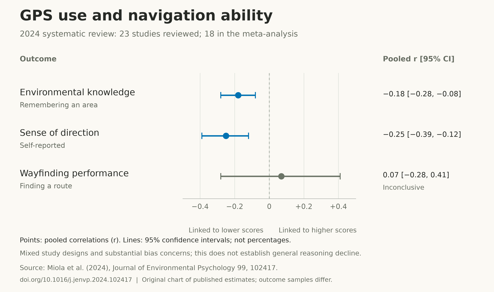

+++
title = "AI Helps Us Do More. But Do We Still Read?"
description = "A year of working with AI has made me question how much we read, understand and take responsibility for."
slug = "when-everyone-can-write-who-still-understands"
article_id = "when-everyone-can-write-who-still-understands"
genre = "essay"
date = 2026-10-19T00:00:00+08:00
draft = false
time_sensitive = false
author = "Meor Ajrul"
tags = ["AI", "work", "reading"]

[cover]
image = "hero-v2.png"
alt = "A reader studies a source document while a geometric AI robot scans its highlighted passage with blue light amid streams of papers and map routes."
caption = "Conceptual illustration, generated with AI."
relative = true
hidden = false
+++
I want AI to be the good guy in this story. It can help us work through information and get more done. In [a writing experiment by Noy and Zhang](https://cepr.org/voxeu/columns/productivity-effects-generative-artificial-intelligence), people completed specific writing tasks faster and received better quality ratings.

But this is where I struggle. Colleagues produce far more with AI, yet still struggle to make decisions from it. Some have not even read what they pass along. They still expect an action plan.

That frustrates me. The words are there. The understanding and responsibility are harder to find. I want us to walk the talk: read the work, explain what it means and be ready to act on it.

Google Maps and Waze offer a useful comparison. We can follow directions without learning the route. A [2024 review of 23 navigation studies](https://doi.org/10.1016/j.jenvp.2024.102417), combining results from 18, found small links between GPS use and poorer knowledge of places, and a lower self-rated sense of direction. Results for finding routes were unclear. Most studies had a medium or high risk of bias. This does not prove a loss of general reasoning, harm from either app, or the same effect from AI.

*Original chart of published results from Miola et al. (2024), section 3.3. These numbers show relationships, not percentage losses or measured drops in a person's ability. [Chart data](gps-navigation-effects.csv).*

Back at work, I want a simple way to close that gap:

- **Make the direction clear.** Leaders say what matters, what result is needed and what success looks like.
- **Name the person responsible.** Each job scope has an owner, the power to make agreed decisions and clarity about whose help is needed.
- **Bring a plan.** Read and check the output. Recommend a next step, name the actions and dates, and flag decisions that need help.
- **Make follow-through part of the KPI.** Judge progress by agreed results, milestones and commitments kept. A document alone is not finished work.

Owning the work also means asking for help when something is outside your control. Leaders must settle clashing priorities and give people enough authority. This is an approach I want to try; I cannot claim it has already worked.

AI can help here too. [Skills save reusable instructions and resources](https://www.anthropic.com/engineering/equipping-agents-for-the-real-world-with-agent-skills), such as a checklist for checking sources. But an agent still needs the latest brief and original documents. [Summaries of long conversations can lose important details](https://www.anthropic.com/engineering/effective-context-engineering-for-ai-agents). If it skips a check, we need to understand why before calling it “lazy.”

Iqra, the call to read in [Qur'an 96:1](https://quran.com/96/1), makes this personal for me. [Hasrizal also links Iqra and AI to checking information and taking responsibility](https://hasrizal.substack.com/p/from-iqra-to-the-age-of-ai-what-al).

For me, reading means caring enough to understand what I put forward. AI can help me prepare the work. I still have to stand behind it.
