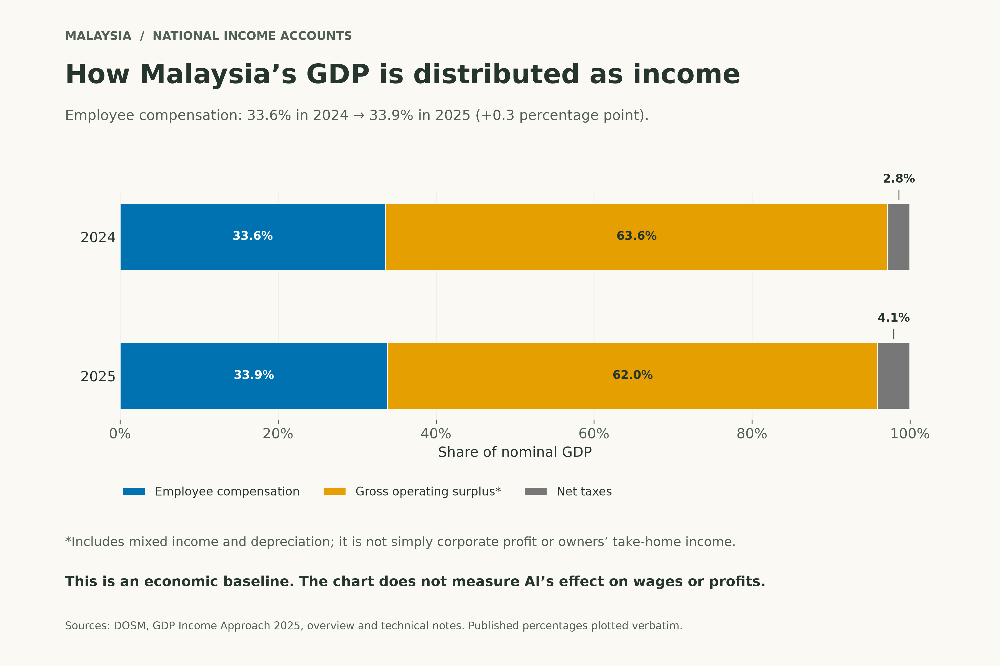
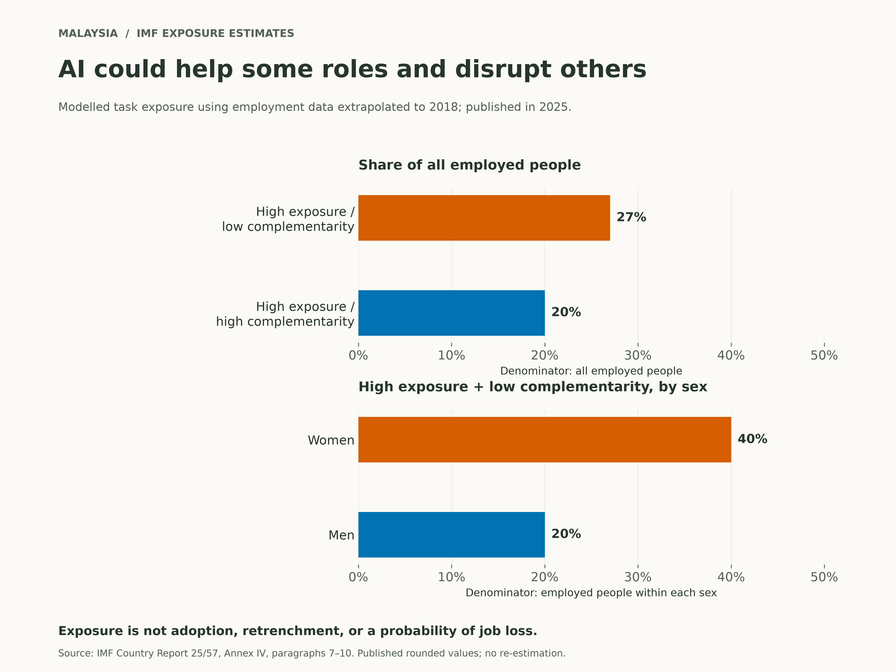

+++
title = "Will Work Still Have Meaning in the Age of AI?"
description = "If AI can do more of our work, what happens to our own contribution? A personal question, grounded in Malaysia’s income data and IMF estimates."
slug = "work-meaning-ai-malaysia"
article_id = "work-meaning-ai-malaysia"
genre = "essay"
date = 2026-10-22T00:00:00+08:00
draft = false
time_sensitive = true
author = "Meor Ajrul"
tags = ["AI", "work", "Malaysia", "meaning"]
[cover]
image = "hero.png"
alt = "A blank notebook and pencil beside a laptop on a sunlit wooden desk."
caption = "AI-generated editorial illustration."
relative = true
hidden = false
+++

If AI can do everything, what would be left for me to do?

I wonder whether work with AI will become a kind of art. We choose what to make and add our own touch. Or would it become another gig, with a little personal flavour to help us stand out?

And if we reach a point where everyone has enough, would work still have meaning? Where would that leave us?

These are questions, not a future I can prove. To explore them from Malaysia, I need to start closer to the ground: with what the numbers actually show.

## First, what do people earn from work?

According to [DOSM’s income accounts](https://www.dosm.gov.my/portal-main/release-content/gross-domestic-product-income-approach-2025), employee compensation made up 33.9% of Malaysia’s GDP in 2025, up from 33.6% in 2024. This includes pay, benefits in kind and employers’ social contributions, as [DOSM’s definitions explain](https://www.dosm.gov.my/portal-main/release-document-log?release_document_id=20282).

*Chart based on DOSM’s published figures. Employee compensation’s share rose by 0.3 percentage point. This chart does not measure AI’s effect on income. [Data](malaysia-income-shares.csv) · [PDF](malaysia-income-shares.pdf).*

The largest part of the chart is called “gross operating surplus”. It would be easy to read that as money going straight to company owners. But it includes income from businesses run by owners and their households, as well as depreciation—the recorded loss in value of assets. It is not all corporate profit. Those details are set out in [DOSM’s technical notes](https://www.dosm.gov.my/portal-main/release-document-log?release_document_id=20282).

For my question, this is a starting point. The chart shows how income from production is recorded. It cannot tell me whether someone feels proud of their work, has enough to live on, or has seen their pay change because of AI.

## What might change with AI?

The [IMF’s 2025 Malaysia report](https://www.imf.org/-/media/files/publications/cr/2025/english/1mysea2025001-print-pdf.pdf) looks at which jobs AI could affect and where it could help people do their tasks.

It estimates that about 27% of employed people were in jobs with high AI exposure but low “complementarity”—less potential for AI to help the worker. Another 20% were in highly exposed jobs with more potential for AI to help. The first category covered about 40% of employed women, compared with 20% of employed men.

*Historical estimates, not counts of lost jobs. The top panel compares shares of all employed people. The bottom panel compares shares within each sex. The employment figures were estimated for 2018. [Data](malaysia-ai-exposure.csv) · [PDF](malaysia-ai-exposure.pdf).*

The age of the data matters. The IMF used detailed job shares from 2000 to estimate the job mix in 2018. It assumed those shares stayed fixed within broader job groups. That assumption has not been independently checked here.

So I cannot read this chart as a picture of what happened to Malaysian workers in 2026. It also does not tell me whether AI made their work feel more or less worthwhile.

## A possible effect is not a measured outcome

In [his September 2026 commentary](https://www.krinstitute.org/publications/why-ai-is-not-yet-behind-malaysias-job-losses), KRI researcher Mikhail Rosli makes a useful distinction: knowing that AI could do some tasks does not show that employers used it to replace workers. He calls for data linking actual AI use to what happens to workers.

That does not prove nobody has been affected. It means the evidence needs to match the claim.

To answer the income question, we would need to know who used AI and what happened to jobs and earnings afterwards. To answer the meaning question, we would also need evidence about people’s experience of the work. Neither chart measures that.

## Back to my question

Would my own touch still matter if AI could produce the work? Would I be creating something, or simply choosing between its suggestions?

Those questions are still open. The Malaysian evidence here does not show that all work will become gigs, that human effort will become unnecessary, or that everyone will share in abundance.

It also does not answer what work means to the person doing it.

That is where my original question remains: if AI can do more of the work, what would make our own contribution worth making?
